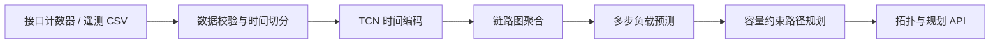

# RouteCast：面向路由链路的图时序预测与容量感知调度

将路由器接口遥测转成未来负载预测，并为新增视频、语音业务生成带容量约束的路径建议。适合展示网络背景与深度学习、模型服务化结合的能力。

**当前定位：可运行研究 / 工程原型。已在模拟数据上完成 CPU 训练和评估，不代表真实网络上线效果。**

## 技术栈与已实现功能

- Python、PyTorch：膨胀时序卷积 + 链路图邻域聚合，32 步输入、6 步预测。
- 图建模：共享路由节点的链路建立邻接关系，行归一化；附 temporal-only 消融。
- 数据工程：按时间 65% / 15% / 20% 切分，训练集拟合标准化参数，避免目标泄漏。
- 网络调度：最大预测负载预留、90% 容量阈值、多业务顺序分配、切换惩罚、容量不足拒绝。
- 接入：自定义拓扑 + CSV；Prometheus 导出的 SNMP `ifHCOutOctets` 计数器转 Mbps。
- 工程：FastAPI、Pydantic、交互式拓扑页面、ONNX Runtime 数值校验、Docker、pytest、GitHub Actions。



## 快速运行

Python 3.11 / 3.12，在本仓库根目录执行：

```bash
python -m venv .venv
# Windows: .venv\Scripts\activate
# Linux/macOS: source .venv/bin/activate
python -m pip install -r requirements-dev.txt
# 仓库自带已训练 CPU 权重，可直接启动
python -m uvicorn routecast.api:app --host 127.0.0.1 --port 8001
```

打开 http://127.0.0.1:8001；API 文档在 `/docs`。点击“增加入口负载”可观察调度建议变化。

```bash
python -m routecast.train --epochs 18
python -m routecast.benchmark
python -m pytest -q
python -m pip install -r requirements-export.txt
python -m routecast.export_onnx
docker compose up --build
```

Docker 配置已提供，本次环境没有 Docker，尚未实际构建镜像。页面仅监听本地时无需账号；共享部署前需要增加认证、限流和任务队列。

## 接入真实路由数据

拓扑使用 JSON 数组：

```json
[{"id":"r1-r2","source":"r1","target":"r2","capacity_mbps":100,"latency_ms":2}]
```

遥测 CSV：

```csv
timestamp,link_id,load_mbps,capacity_mbps
0,r1-r2,35.0,100
60,r1-r2,36.0,100
```

`timestamp` 为数值秒、固定采样间隔，每个时间点包含全部链路，至少 100 个时间点；容量必须与拓扑一致。拒绝缺值、重复和不规则采样，不静默填充。实际训练建议提供数周数据，并采用滚动时间回测。

```bash
python -m routecast.train --csv data/private/telemetry.csv --topology data/private/topology.json
```

如果已有 Prometheus `query_range` 导出结果，映射表格式为 `{"router1:9116/2":{"link_id":"r1-r2","capacity_mbps":100}}`，键为 `instance/ifIndex`：

```bash
python -m routecast.ingest data/private/prometheus.json data/private/interface_mapping.json data/private/telemetry.csv
```

转换器按相邻字节计数差分计算 Mbps；计数器复位需人工分段处理。当前按双向共享容量建模；生产网络的上下行链路应拆成有向容量，不能直接套用该简化。

## 实测结果与可复现性

固定种子 42，1600 个模拟时间点、9 条链路；样本构造和数据 SHA-256 见 `artifacts/metrics.json`。MAE 单位是负载占容量比例，0.0325 表示平均误差约 3.25 个百分点。

| 模型 | 测试 MAE | 测试 RMSE |
|---|---:|---:|
| 持久性预测 | 0.05869 | 0.08307 |
| 48 步周期基线 | 0.10717 | 0.14471 |
| 仅时序卷积 | 0.03463 | 0.04905 |
| 图时序模型 | **0.03250** | **0.04758** |

图时序模型较持久性基线 MAE 下降约 44.6%，较仅时序卷积下降约 6.2%。这是模拟数据上的单种子实验，不构成统计显著性结论。

独立测试时段按六步间隔回放 106 次业务分配机会：

| 策略 | 接纳次数 | 已接纳区间容量超 90% 次数 | 路径切换 |
|---|---:|---:|---:|
| 延迟最短路径 | 106 | 7 | 0 |
| 基于最新负载 | 106 | 9 | 4 |
| 基于预测负载 | 105 | 2 | 10 |

预测调度以少接纳一次、更多切换换取更少容量超限。这里只是背景流量外生的时段回放，没有包级仿真、流量反作用或实际设备测试。

ONNX opset 17，batch=1/4 最大绝对误差 `4.77e-7`；模型 6126 参数。导出模型输入输出是标准化数值，标准化元数据见 `artifacts/preprocessing.json`。本地训练时间不是部署吞吐基准。

## 目录

```text
routecast/    数据、模型、训练、接入、推理、规划、API 与网页
tests/        时间边界、梯度、容量竞争、切换惩罚、CSV、计数器与 API 测试
artifacts/    权重、ONNX、指标、拓扑和模拟样例
docs/         面试说明与模型卡
```

## 设计取舍

当前预测在给定拓扑上训练；改变链路数量需重训。规划器为按需求大小排序的贪心算法，无法保证全局多商品流最优。权重只从本地已知路径加载，不通过 HTTP 接受 checkpoint。系统不会连接、修改或下发任何路由器配置。

下一步应接入授权遥测，增加多种子和跨周滚动验证、链路故障场景、置信区间、Mininet 测试与切换成本敏感性分析。

参考：[RFC 2863 接口 MIB](https://www.rfc-editor.org/rfc/rfc2863)、[RFC 7011 IPFIX](https://www.rfc-editor.org/rfc/rfc7011)、[RFC 2328 OSPF](https://www.rfc-editor.org/rfc/rfc2328)。本项目实现自定义规划器，不实现 OSPF 或 IPFIX 协议栈。
